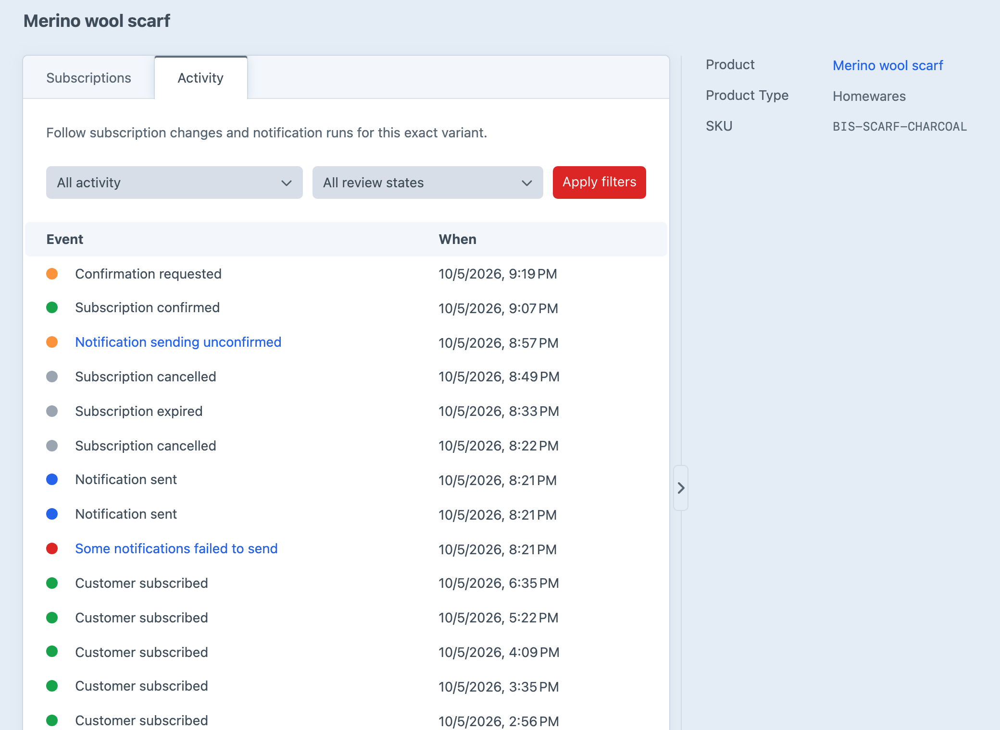
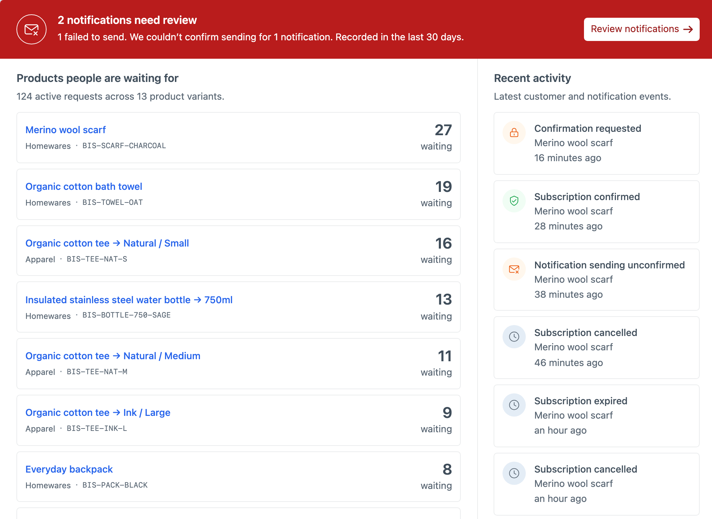
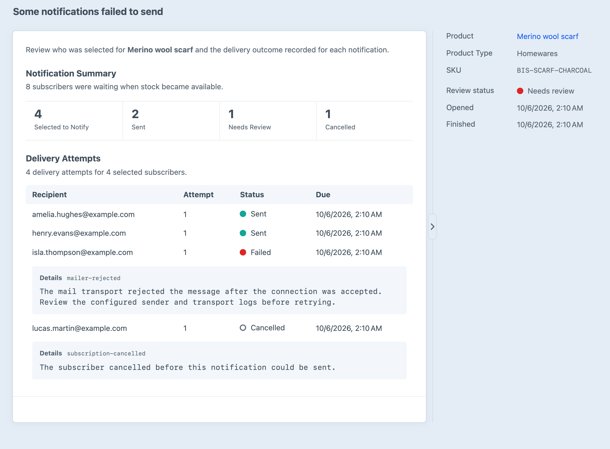

# Notification Activity

Notification activity shows what Back in Stock did when a variant became available. It records who was selected and the result each time an email was processed, rather than reducing the whole restock to a single “email sent” entry.

## Selecting Recipients

The **Notification Recipients** setting controls how many waiting customers are selected for a restock.

**Match available stock** starts with the oldest waiting subscriptions and limits the number selected according to the stock on hand. **Subscribers per Available Unit** can widen that selection when not every notified customer is expected to purchase. For example, five available units with two subscribers per unit selects up to ten people. Variants with unlimited native stock select everyone who is waiting. When [`stockFieldHandle`](docs:get-started/configuration#stockfieldhandle) is configured, its quantity sets the limit even if Commerce inventory tracking is disabled.

**Notify all waiting subscribers** selects everyone currently waiting, regardless of the available quantity.

Both policies select the oldest subscriptions first. Selecting a recipient does not reserve stock or guarantee that the item will still be available when they visit the store.

## Processing Larger Lists

Selected recipients are processed in groups through Craft’s queue. **Batch Size** controls how many emails are scheduled in each group, and **Batch Delay** spaces later groups apart.

Before processing an email, Back in Stock confirms that the subscription is still waiting and the variant is still available. If stock disappears, the affected messages are cancelled rather than sent. This is why a notification can contain selected recipients who did not ultimately receive an email.

## Sending Results

Each delivery attempt records one of these outcomes:

- **Sent** means Craft’s mailer accepted the message. It does not confirm that the email reached the inbox, was opened, or led to a purchase.
- **Failed** means Craft’s mailer did not accept the message. Back in Stock can retry a definite failure up to the configured maximum.
- **Cancelled** means the subscription or product availability changed before delivery.
- **Unconfirmed** means Back in Stock could not determine whether the mailer accepted the message. It is not retried automatically because doing so could send a duplicate.

A single notification can cover many recipients, and one recipient can have several attempts when a definite failure is retried. The summary uses the latest recorded result for each selected subscription, while the table keeps the individual attempts and any error messages.

## Following Notifications for a Variant

Each variant's **Activity** tab lists its restock notifications alongside its subscription changes, in date order, so you can see who joined, verified or left the waiting list before a restock and what was sent afterwards. Each notification shows how many emails were sent and how many subscribers were selected out of those waiting, and opening it shows the details for every recipient.

A notification's page shows how many subscribers were waiting, how many were selected, and the latest result for each recipient, with timestamps and any recorded error beneath the relevant attempt. Its details include the **Notification Recipients** setting that applied and the stock found at the last check, and the summary explains how many subscribers that stock allowed. This answers the usual questions after a restock, such as why some customers were notified and others are still waiting.

## Finding Notifications That Need Review

A notification needs review when any of its emails failed or couldn't be confirmed, and stays that way until someone marks it as reviewed. While any notification from the last 30 days needs review, the **Overview** shows an alert with how many emails failed and how many couldn't be confirmed. **Review notifications** opens the affected notifications directly when they all belong to one variant, or **Products** filtered to the affected variants otherwise.

In **Products**, the **Needs review** filter shows the same variants, and each one shows how many emails need review beside its title. Opening the variant takes you to its notifications that need review, with a note above the list and a link back to all of its activity. On the notification's page, failed and unconfirmed results are marked for review, and the recorded error code and message help you tell a mail configuration problem from a change in stock or eligibility.

## Acting on Review Items

Admins, and users with the **Retry failed notifications and mark notifications as reviewed** permission, can act on a notification from its detail page:

- **Retry failed sends** queues another attempt straight away for each subscriber whose latest attempt failed and who is still waiting, even when the automatic **Maximum Delivery Attempts** have been used. Stock and the subscription are checked again before sending, so a variant that has sold out cancels the attempt instead. Unconfirmed sends are never retried, because the message may already have been delivered.
- **Mark as reviewed** records that the problem has been dealt with, for example after checking the mail provider’s logs for an unconfirmed send. The notification keeps its results but no longer counts towards the Overview alert or the **Needs review** filter. If a later attempt fails or can’t be confirmed, it needs review again.
