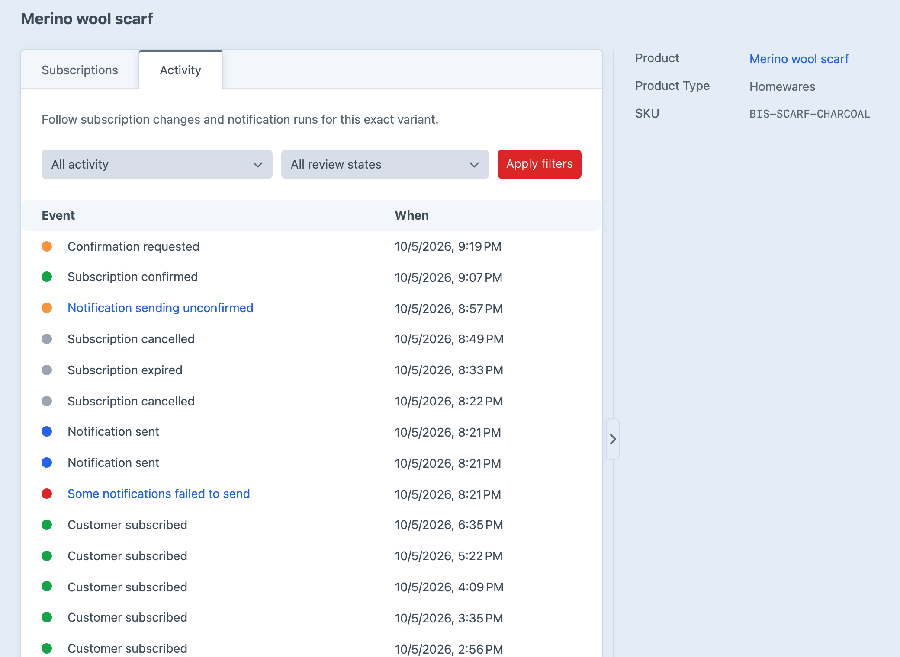
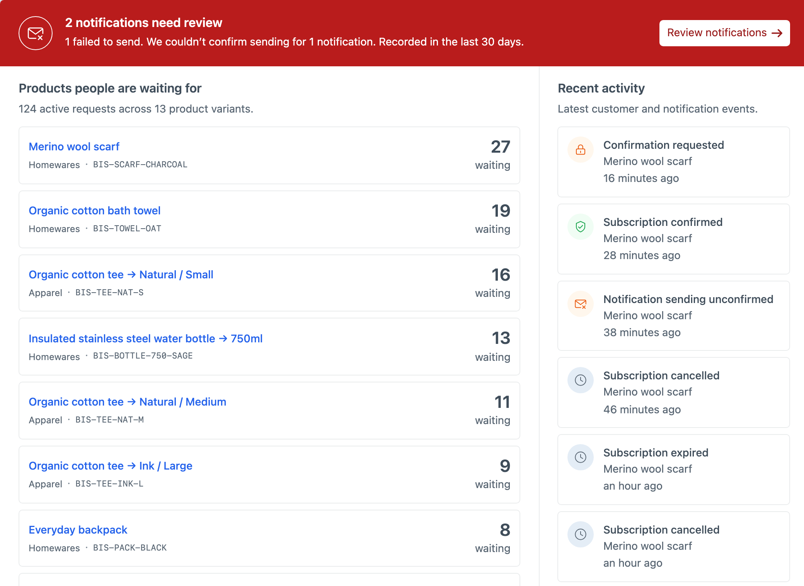
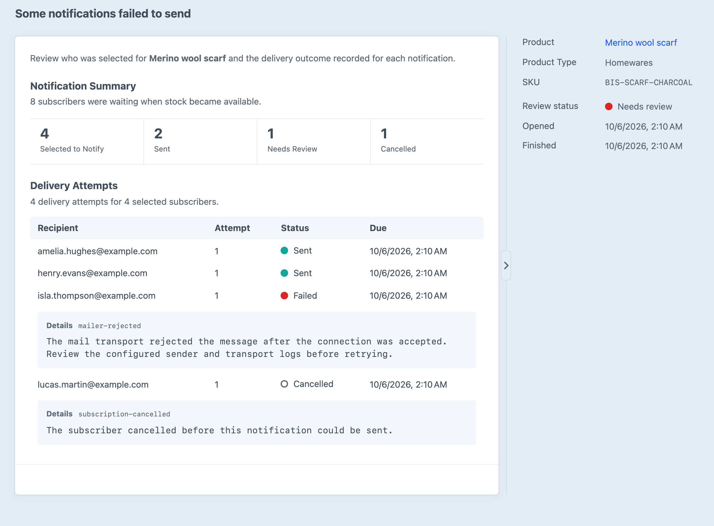

# Notification Activity

Notification activity shows what Back in Stock did when a variant became available. It records who was selected and the result each time an email was processed, rather than reducing the whole restock to a single “email sent” entry.

## Selecting Recipients

The **Notification Recipients** setting controls how many waiting customers are selected for a restock.

**Match available stock** starts with the oldest waiting subscriptions and limits the number selected according to the stock on hand. **Subscribers per Available Unit** can widen that selection when not every notified customer is expected to purchase. For example, five available units with two subscribers per unit selects up to ten people. Variants with unlimited native stock select everyone who is waiting. When [`stockFieldHandle`](docs:get-started/configuration#stockfieldhandle) is configured, its quantity sets the limit even if Commerce inventory tracking is disabled.

**Notify all waiting subscribers** selects everyone currently waiting, regardless of the available quantity.

Both policies select the oldest subscriptions first. Selecting a recipient does not reserve stock or guarantee that the item will still be available when they visit the store.

## Processing Larger Lists

Selected recipients are processed in groups through Craft’s queue. **Batch Size** controls how many emails are scheduled in each group, and **Batch Delay** spaces later groups apart.

Before processing an email, Back in Stock confirms that the subscription is still waiting and the variant is still available. If stock disappears, the affected messages are cancelled rather than sent. This is why a notification can contain selected recipients who did not ultimately receive an email.

## Sending Results

Each delivery attempt records one of these outcomes:

- **Sent** means Craft’s mailer accepted the message. It does not confirm that the email reached the inbox, was opened, or led to a purchase.
- **Failed** means Craft’s mailer did not accept the message. Back in Stock can retry a definite failure up to the configured maximum.
- **Cancelled** means the subscription or product availability changed before delivery.
- **Sending unconfirmed** means Back in Stock could not determine whether the mailer accepted the message. It is not retried automatically because doing so could send a duplicate.

A single notification can cover many recipients, and one recipient can have several attempts when a definite failure is retried. The summary uses the latest recorded result for each selected subscription, while the table keeps the individual attempts and any error messages.

## Reviewing Activity

Open a variant’s **Activity** tab to follow subscription changes and restock notifications in chronological order. Subscription events explain when a customer joined, verified, or left the waiting list. Notification entries open a detail page showing who was selected, the latest result for each email, timestamps, and any recorded error details.

Failed and unconfirmed outcomes are marked for review on the detail page and in the Overview alert. **Review notifications** opens the affected notifications directly when they belong to one variant, or the Products list filtered to notifications needing review. The recorded error code and message can help distinguish a mail configuration problem from an eligibility or stock change.

Open an affected notification to see how many subscribers were waiting, how many were selected, and the latest result for each recipient. The details sidebar shows the **Notification Recipients** setting and the stock found at the last check, and the summary explains how many subscribers that stock allowed. Error details appear beneath the relevant attempt so longer mail messages remain readable.

