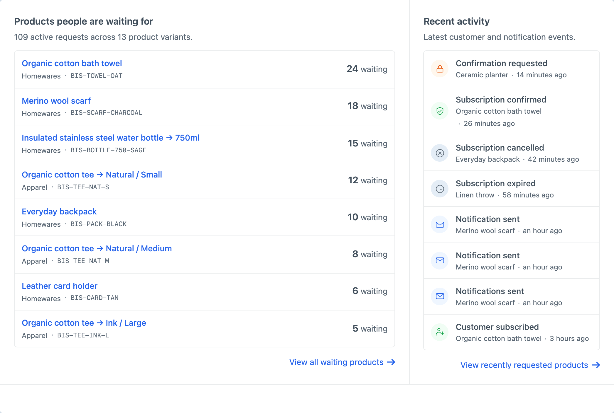
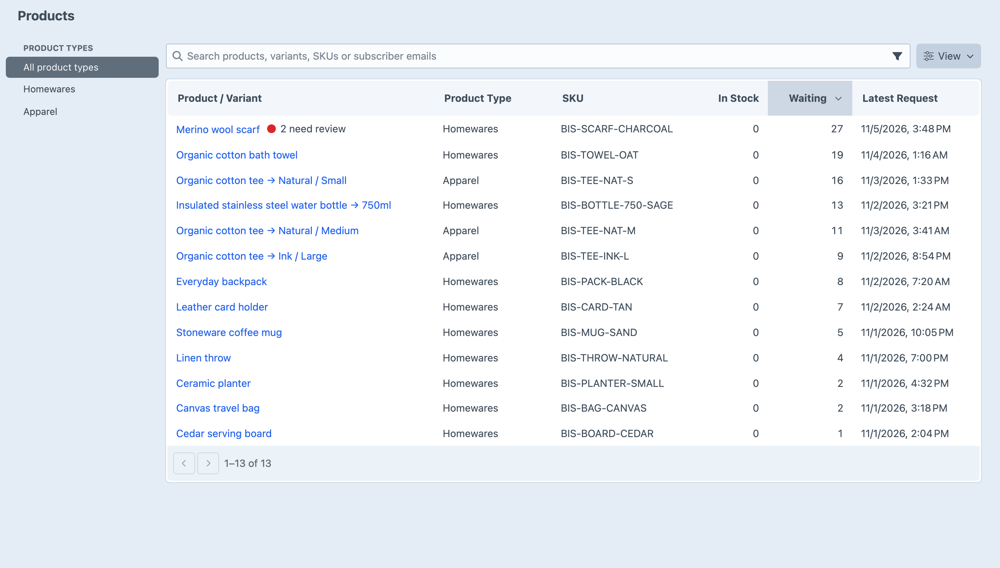

# Product Demand

Every subscription is for one exact Commerce variant, so Back in Stock can show you demand at the level customers actually buy. You can see which out-of-stock products have the most people waiting, whether that interest is for one particular size or colour, and how many people were waiting before an earlier restock. This is useful when deciding what to reorder first, or how many units of each option to order.

Product demand is in the plugin's section of the control panel, under **Back in Stock** unless you've changed its **Plugin Name**. Anyone with the **Access Back In Stock** permission can see it, as described on [Permissions](permissions.md).

## Seeing What Customers Are Waiting For

The **Overview** lists the eight variants with the most customers waiting, along with the total number of active requests across the store. A customer counts as waiting once their subscription is active, so requests that are still pending email verification aren't included. Select a variant to see who is waiting for it, or choose **View all waiting products** for the full list.

Beside the waiting list, **Recent activity** shows the latest subscriptions, verifications, cancellations and restock notifications across every product. It's a quick way to notice a product that has suddenly attracted interest, or to confirm that a restock email has gone out.

## Comparing Products and Their Variants

**Products** lists every variant customers have subscribed to, with one row per variant. A product's sizes or colours each get their own row, so demand for **Natural / Small** and **Natural / Medium** stays separate instead of being added together. The list isn't a copy of your Commerce catalogue. A variant appears once someone subscribes to it, and stays while any of its subscriptions are kept.

Rows are ordered by the number of people waiting, so the variants with the most demand are at the top. Each row also shows the variant's current stock, read from Commerce inventory or the configured [`stockFieldHandle`](docs:get-started/configuration#stockfieldhandle), so you can compare what's on hand with how many people want it.

To focus on part of your catalogue, choose a product type in the sidebar, or search by product title, variant title or SKU. Searching for a product title lists each of its variants that customers have subscribed to. **Filters** can limit the list to variants people are waiting for now (**Waiting now**) or variants whose demand has passed (**Past demand**), and sorting by **Latest Request** brings the most recently requested variants to the top. Search, filters and sorting apply to the whole list, including rows on other pages.

**View** lets you choose which columns to show and in what order. Your choices on **Products**, and on each variant's subscription list, are remembered for your account in this browser, and **Use defaults** clears them. A sort order in a link you follow, such as **View all waiting products** on the Overview, takes priority over your saved one.

## Looking Back at a Variant's Demand

Open a variant to see who wanted it and what happened when it came back. Its details show the product, variant, product type, SKU and current stock, and link to the Commerce product when you need to change its inventory. The variant's **Subscriptions** list shows the people waiting for it, and **Activity** shows each subscription change and restock notification in date order, so you can see how many people joined before a restock and how many were notified. [Subscriptions](subscriptions.md#checking-whether-a-customer-is-waiting) explains how to search the list for one person, and [Notification Activity](notification-activity.md) explains what a restock notification records.

A variant's history stays available after nobody is waiting for it. Choose **Past demand** in **Products** to find variants that were wanted before, which helps when planning stock for a product's next season or deciding whether a discontinued option is worth bringing back. Notified, cancelled and expired subscriptions are removed after the number of days set by [**Completed History Retention**](docs:get-started/configuration#historyretention), and a variant leaves **Products** once its last subscription has been removed.
