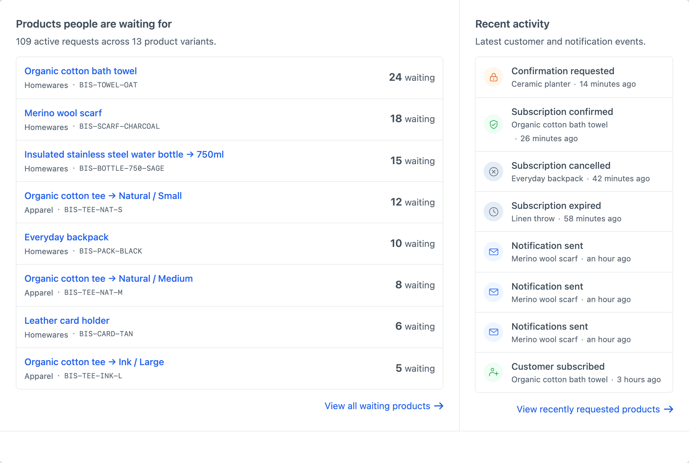
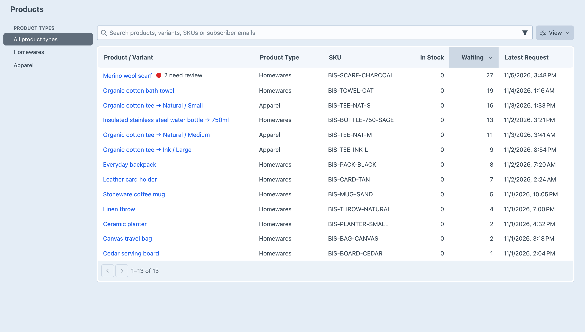
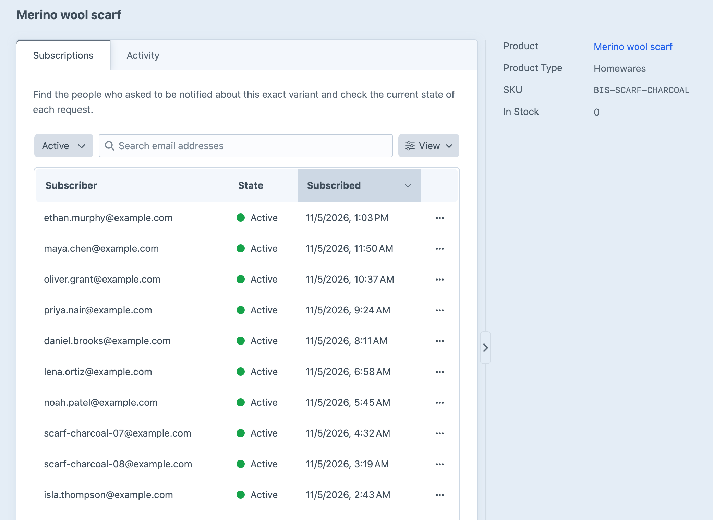

# Products and Demand

Back in Stock organises customer interest around exact Commerce variants. This lets you answer practical questions such as which items have the most customers waiting, whether demand belongs to a particular size or colour, and which product is associated with a customer’s email address.

## Reading the Overview

The **Overview** shows how many customers are currently waiting for each product variant, alongside the latest subscription and notification changes across the store. Products with the most waiting customers appear first.

The notification banner appears only when a delivery needs attention. A failed notification means the mailer did not accept the message. An unconfirmed notification means the plugin could not prove whether the mailer accepted it, so it is retained for review rather than retried automatically and potentially sent twice.

Use the Overview to spot demand or delivery problems, then move into **Products** when you need the complete list or the history for one variant.

## Finding a Product or Customer

The **Products** screen contains variants with current or past Back in Stock information. It is not a second copy of the full Commerce catalogue: a variant appears because it has subscriptions or notification history.

You can filter the list by Commerce product type, sort any column, or search by product title, variant title, SKU, or subscriber email. Searching by email is useful when a customer asks whether they are still waiting for an item. Searching a product title shows each relevant variant separately, making differences such as **Natural / Small** and **Natural / Medium** visible.

Use **Filters** to narrow the list to current or past demand, or notifications needing review. **View** lets you change the sort direction and choose which columns to show and in what order. Search and filters apply to the full list, including records on other pages. **View** preferences are remembered for your account in this browser on Products and Subscriptions; subscription preferences apply across all products. Sorting specified in a link takes priority. Choose **Use defaults** to clear your saved view preferences.

## Inspecting an Exact Variant

Open a product and variant row to see its Back in Stock history. The details sidebar identifies the Commerce product, variant title when applicable, product type, and SKU. The main content is divided into two views:

- **Subscriptions** shows the customers who have asked to be notified and the current state of each request.
- **Activity** shows subscription changes and restock-notification work in chronological order.

In **Subscriptions**, use the **Status** dropdown beside search to choose a request state, or choose **All statuses** to see all retained states. **Activity** shows subscription changes and notification sending in chronological order, with pagination below the table.

The Commerce product link in the details sidebar opens the underlying product when you need to inspect or change its catalogue and inventory information.

Historical rows remain useful after the current waiting count reaches zero. They explain what happened during an earlier restock and support customer enquiries without presenting past interest as current demand. Completed history is removed according to the **Completed History Retention** setting.
