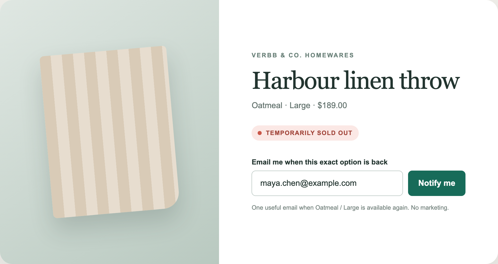
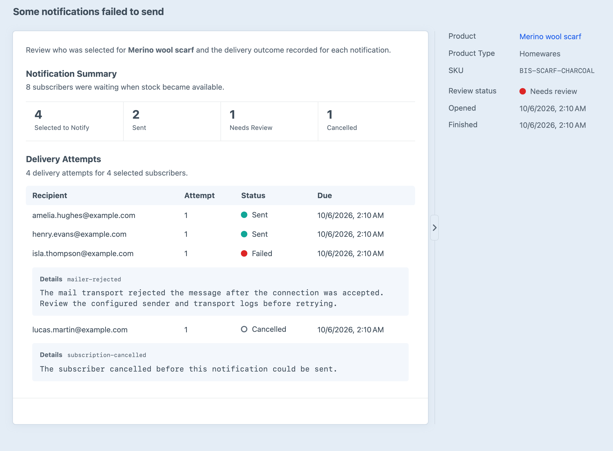
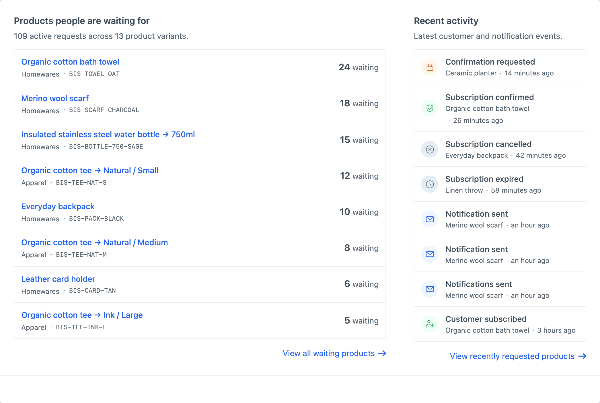
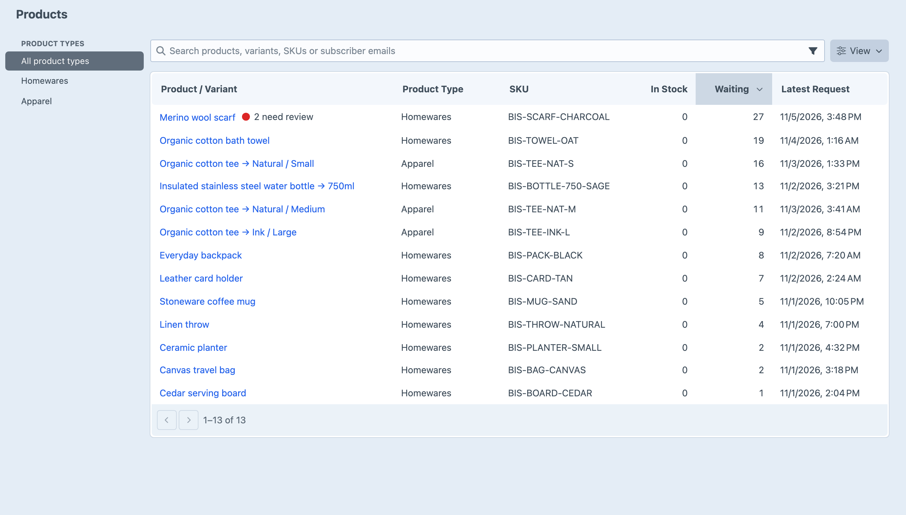
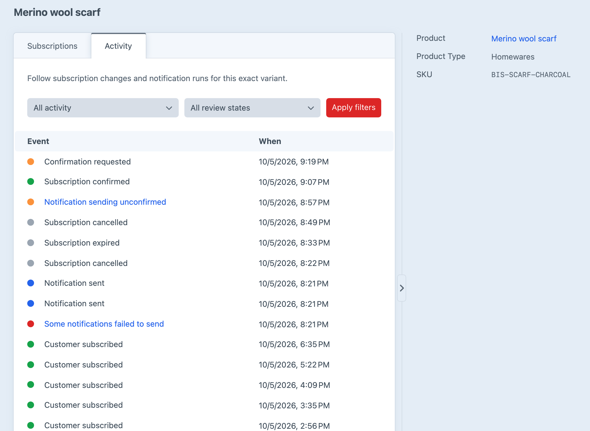

<!-- feature-intro -->
Let customers enter their email address to be notified when a sold-out Craft Commerce variant becomes available again. See who is waiting, choose how many people to notify, and review what happened when Back in Stock tried to send each email.
<!-- feature-intro-end -->

<!-- feature-section media-size="large" -->
## Build a waiting list for each variant

Add an unstyled notification form wherever a sold-out variant appears. Guests and signed-in customers can join the list for the size, colour, or configuration they want, while repeated submissions for the same variant and email address remain a single request.

<!-- feature-section-end -->

<!-- feature-section media-size="large" -->
## Choose how many customers to notify

Start with the oldest requests based on the quantity available, increase the number of people contacted for each unit, or notify everyone waiting. Back in Stock groups repeated stock updates while a variant remains available so the same request is not selected twice for that restock.

<!-- feature-section-end -->

<!-- feature-section media-size="large" -->
## Find current demand and recent activity

Overview shows which products customers are waiting for, how many people are waiting and the latest activity across the store, so you can gauge demand before the stock arrives.

<!-- feature-section-end -->

<!-- feature-section media-size="large" -->
## Find the product or customer you need

Search by product, variant, SKU, or subscriber email without wading through the full Commerce catalogue. Product type filters and sortable columns make it easy to move from a store-wide question to the exact variant behind it.

<!-- feature-section-end -->

<!-- feature-grid -->
- :icon[mail-check] **Verified interest** Optional double opt-in keeps only confirmed recipients active.
- :icon[layers-subtract] **Controlled groups** Process larger lists in configurable groups and retry email attempts that fail before Craft’s mailer accepts them, up to a chosen limit.
- :icon[message-cog] **Editable email** Edit message content through Craft System Messages, or use custom Twig layouts for confirmation and availability emails.
- :icon[link-off] **One-click cancellation** Signed links let recipients leave without an account.
- :icon[history] **Notification history** Review who was selected and whether Craft accepted each message, or whether it failed, was cancelled, or remained unconfirmed.
- :icon[refresh] **Scheduled checks** Catch stock changes missed by an import, expire old requests, and remove completed history when required.
<!-- feature-grid-end -->

<!-- feature-section media-size="large" -->
## See what happened over time

See customers subscribe, verify, cancel, expire, and receive notifications in one chronological view for each variant.

<!-- feature-section-end -->

